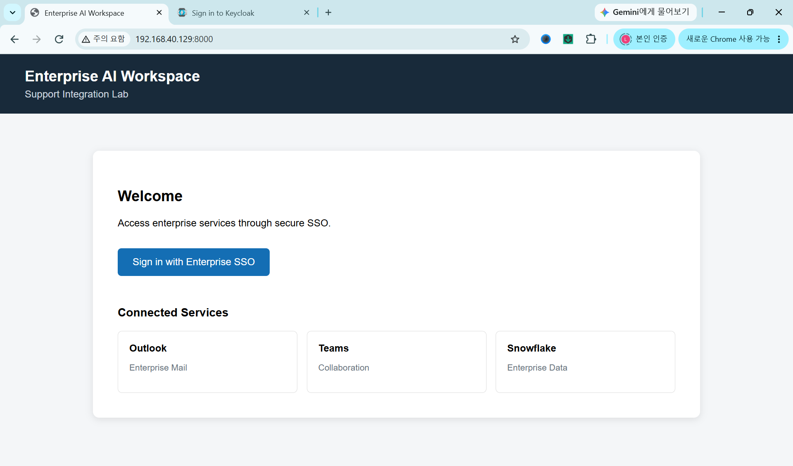
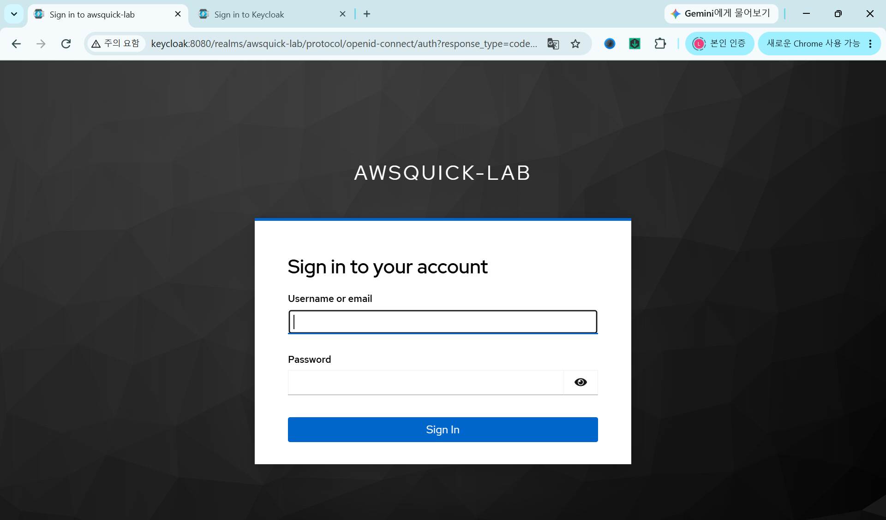
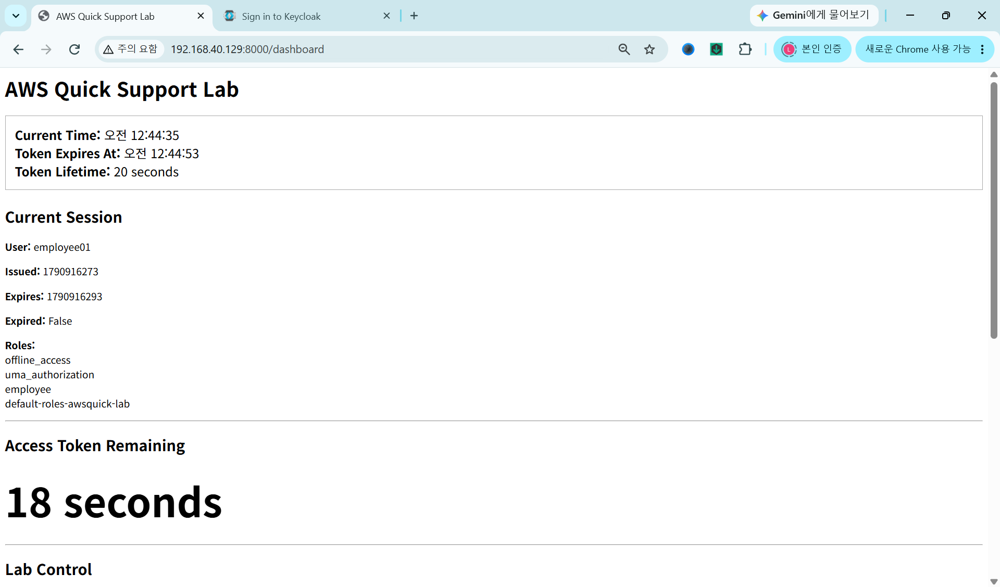
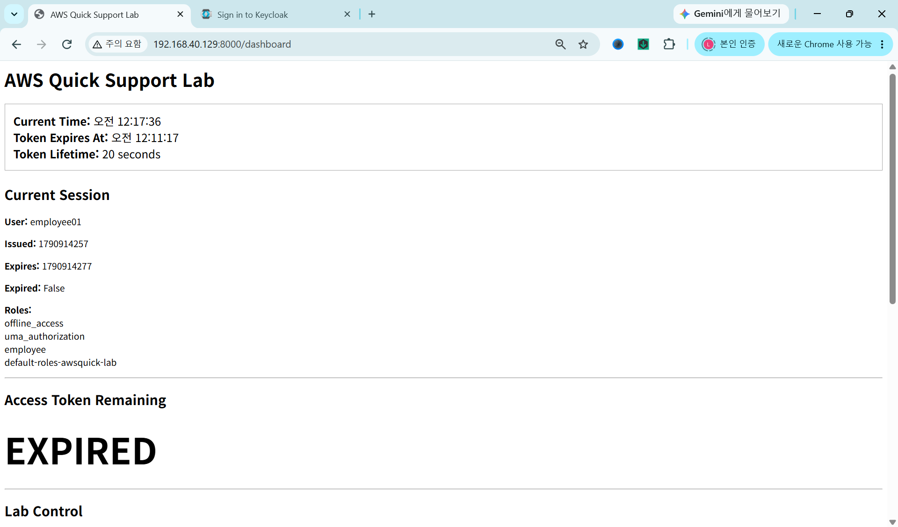
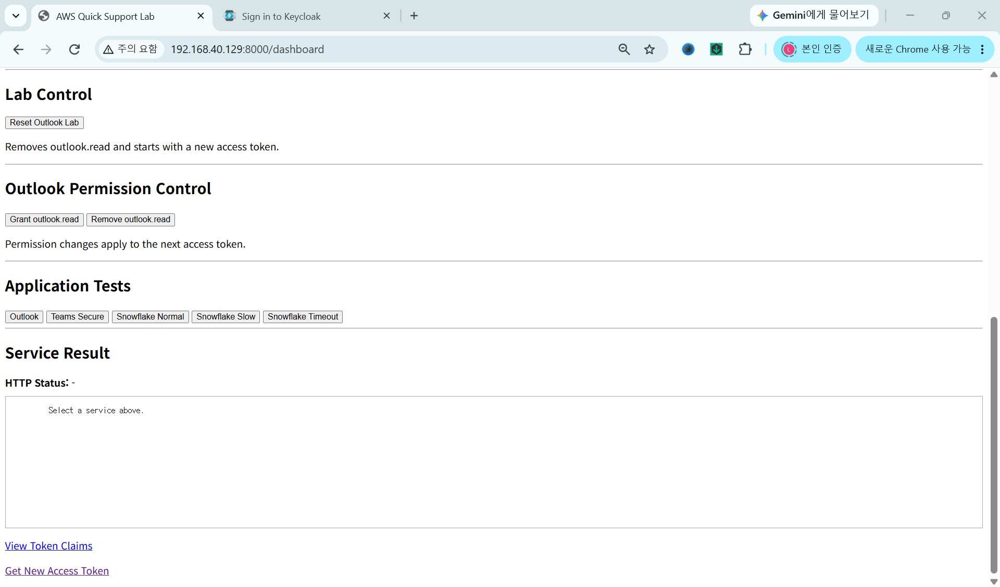
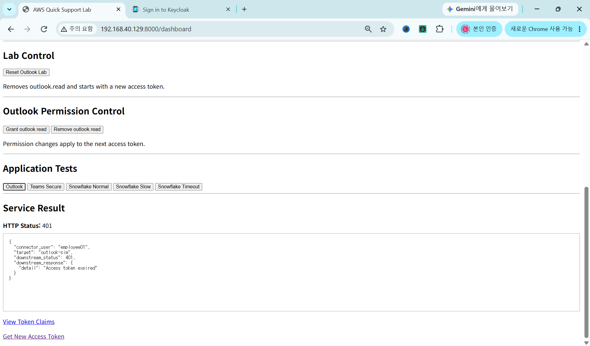
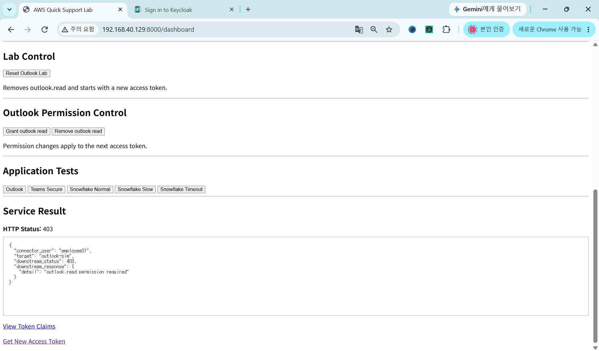
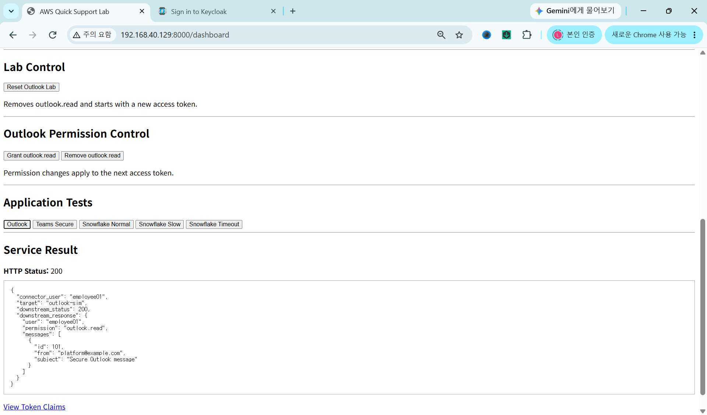
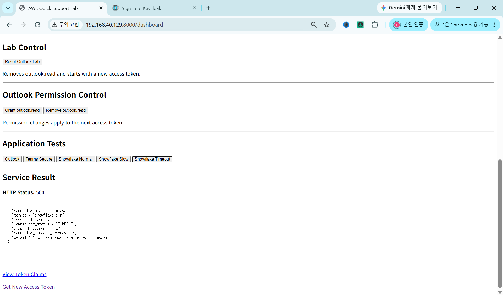

# Enterprise AI Integration & Support Lab

A hands-on enterprise integration and troubleshooting lab that simulates SSO/OIDC authentication, connector-based access to external APIs, authorization failures, token expiration, and backend service timeouts.

The project was built to practice fault isolation across identity, permissions, application connectors, and external services in a containerized environment.

The focus is not simply generating HTTP errors. The goal is to identify which layer is failing, verify the cause, apply a correction, and confirm service recovery.

> This is an independent technical learning project. It is not affiliated with AWS, Microsoft, Snowflake, or any other vendor.

---

## Project Goal

Modern enterprise applications often depend on several systems at the same time:

```text
User
  |
  v
Identity Provider
  |
  v
Enterprise Application
  |
  v
Connector / Integration Layer
  |
  v
External API / Backend Service
```

A user may only report:

```text
"The application is not working."
```

But the actual problem may exist in very different fault domains:

```text
Authentication
Token lifecycle
Authorization / permissions
Application session
Connector
External API
Backend service
Timeout / connectivity
```

This lab provides a repeatable environment for reproducing those failures and troubleshooting them individually.

---

## Architecture

```text
                         User / Browser
                               |
                               v
                  +---------------------------+
                  | Enterprise AI Workspace   |
                  | FastAPI Connector :8000   |
                  +-------------+-------------+
                                |
                 +--------------+----------------+
                 |                               |
                 | OIDC                          | REST API
                 v                               v
        +----------------+            +----------------------+
        | Keycloak :8080 |            | External Services    |
        |                |            |                      |
        | SSO / OIDC     |            | Outlook Sim :8100    |
        | Users          |            | Teams Sim   :8200    |
        | Roles          |            | Snowflake   :8300    |
        | Tokens         |            |                      |
        +----------------+            +----------------------+
```

All services run as Docker containers using Docker Compose.

---

## Components

| Component | Port | Purpose |
|---|---:|---|
| Keycloak | 8080 | SSO / OIDC identity provider |
| Connector | 8000 | Enterprise application and integration layer |
| Outlook Simulator | 8100 | Simulated external business API |
| Teams Simulator | 8200 | Simulated external business API |
| Snowflake Simulator | 8300 | Simulated backend/data service |

---

## Technology Stack

- Ubuntu Linux
- Docker
- Docker Compose
- Python
- FastAPI
- Keycloak
- OAuth 2.0
- OpenID Connect
- REST APIs
- HTTP troubleshooting
- Role-Based Access Control
- Session and token management

---

## Authentication Flow

Keycloak provides authentication for the Enterprise AI Workspace.

```text
User
  |
  | Login
  v
Keycloak
  |
  | Authorization Code
  v
FastAPI Callback
  |
  | Token Exchange
  v
Access Token
  |
  v
Authenticated Application Session
```

The connector receives identity information and roles from the authenticated session and uses that information when making requests to simulated external services.

---

## Session and Token Diagnostics

The lab includes a diagnostic view for checking:

- Authenticated user
- Session state
- Access-token status
- Token expiration
- User roles
- Current authorization state

A valid session establishes the known-good baseline before a failure is introduced.

Example:

```text
User           : manager01
Session        : ACTIVE
Token          : VALID
Authentication : SUCCESS
```

---

## Token Expiration Test

The Keycloak access-token lifetime was intentionally shortened during testing so token expiration could be reproduced quickly.

Example test configuration:

```text
Normal token lifetime:
300 seconds

Fault-injection token lifetime:
10 seconds
```

After the token expires, the application can reproduce an authentication-related API failure without waiting for a normal production token lifetime.

---

# Tested Incident Scenarios

## 1. Active Session / Valid Token

The user authenticates successfully through Keycloak and enters the Enterprise AI Workspace.

Expected state:

```text
Authentication : SUCCESS
Session        : ACTIVE
Token          : VALID
```

This is the known-good baseline.

---

## 2. Expired Access Token

The token lifetime is intentionally reduced and the application waits until the access token expires.

Expected state:

```text
Authentication : previously successful
Session        : present
Token          : EXPIRED
```

The expired token is then used to reproduce a downstream authentication failure.

---

## 3. Outlook Authentication Failure — HTTP 401

The connector attempts to access the Outlook simulator using an expired or invalid token.

```text
Connector
    |
    | Expired / Invalid Token
    v
Outlook Simulator
    |
    v
401 Unauthorized
```

### Troubleshooting focus

- Was authentication originally successful?
- Was an access token issued?
- Has the token expired?
- Is the Authorization header present?
- Is the correct token being forwarded?
- Is the identity provider session still valid?

Expected result:

```text
HTTP Status : 401 Unauthorized
Fault Domain: Authentication / Token
```

---

## 4. Authorization Failure — HTTP 403

The user is authenticated successfully but does not have the required application permission.

Example:

```text
Authentication : SUCCESS
Token          : VALID
outlook.read   : MISSING
Result         : 403 Forbidden
```

This demonstrates the difference between authentication and authorization.

```text
401 Unauthorized
= Authentication problem

403 Forbidden
= Authentication succeeded,
  but required authorization is missing
```

In this scenario, the identity provider and login process are functioning correctly.

The failure is caused by permission configuration.

---

## 5. Permission Recovery — HTTP 200

The required permission is restored.

The same Outlook request is executed again.

Expected result:

```text
Authentication : SUCCESS
Authorization  : SUCCESS
External API   : SUCCESS
HTTP Status    : 200 OK
```

This verifies that the previous incident was caused by authorization rather than:

- network connectivity
- authentication
- connector failure
- external API availability

---

## 6. Snowflake Backend Timeout — HTTP 504

The Snowflake simulator intentionally delays its response.

```text
Enterprise AI Workspace
        |
        v
FastAPI Connector
        |
        | API Request
        v
Snowflake Simulator
        |
        | Delayed Response
        |
        X
     Timeout
        |
        v
504 Gateway Timeout
```

### Troubleshooting focus

- Connector health
- Backend service health
- Response latency
- Timeout configuration
- Network reachability
- Whether authentication and authorization already succeeded

Expected result:

```text
HTTP Status : 504 Gateway Timeout
Fault Domain: Backend / Service Response
```

---

# Fault-Domain Isolation

The main purpose of the project is to identify where an incident occurs.

```text
User
 |
 v
Authentication
 |
 +---- Token invalid / expired ----------> 401
 |
 v
Authorization
 |
 +---- Required permission missing ------> 403
 |
 v
Application / Connector
 |
 +---- Session / request / routing
 |
 v
External Service
 |
 +---- Healthy --------------------------> 200
 |
 +---- Slow / unavailable ---------------> 504
```

The same user-facing symptom can therefore originate from very different technical layers.

---

## Troubleshooting Workflow

A typical investigation in the lab follows this sequence:

```text
1. Confirm application availability

2. Confirm user authentication

3. Validate session state

4. Validate access-token status

5. Check user roles and permissions

6. Execute connector request

7. Check HTTP response

8. Verify external-service behavior

9. Identify the failing layer

10. Apply remediation

11. Repeat the same request

12. Confirm recovery
```

---

## HTTP Status Interpretation

| Status | Meaning in This Lab | Primary Investigation Area |
|---|---|---|
| 200 | Successful request | Normal operation |
| 401 | Authentication failure | Token / login / authentication |
| 403 | Authorization failure | Roles / permissions |
| 504 | Backend timeout | External service / response latency |

---

# Screenshots

## 1. Enterprise AI Workspace

Main application workspace.



---

## 2. Keycloak Login

SSO authentication through Keycloak.



---

## 3. Active Session / Token

Valid authenticated session and token state.



---

## 4. Expired Token Status

Access-token expiration reproduced intentionally.



---

## 5. Lab Control / Application Tests

Controls used to execute normal and failure scenarios.



---

## 6. Expired Token — HTTP 401

Authentication failure caused by an expired token.



---

## 7. Permission Denied — HTTP 403

Authenticated user without the required application permission.



---

## 8. Permission Restored — HTTP 200

Successful Outlook request after permission recovery.



---

## 9. Snowflake Timeout — HTTP 504

Backend timeout reproduced through the Snowflake simulator.



---

# Project Structure

```text
forge-awsquick-support-lab/
│
├── README.md
├── compose.yaml
├── .env.example
├── .gitignore
│
├── connector/
│   ├── Dockerfile
│   ├── main.py
│   └── requirements.txt
│
├── outlook-sim/
│   ├── Dockerfile
│   ├── main.py
│   └── requirements.txt
│
├── teams-sim/
│   ├── Dockerfile
│   ├── main.py
│   └── requirements.txt
│
├── snowflake-sim/
│   ├── Dockerfile
│   ├── main.py
│   └── requirements.txt
│
└── screenshots/
    ├── 01_workspace-home.png
    ├── 02_keycloak-login.png
    ├── 03_session-token-active.png
    ├── 04_expired-token-status.png
    ├── 05_lab-control-application-tests.png
    ├── 06_expired-token-401.png
    ├── 07_permission-denied-403.png
    ├── 08_outlook-success-200.png
    └── 09_snowflake-timeout-504.png
```

---

# Security

Sensitive credentials and runtime data are excluded from Git.

The repository `.gitignore` excludes items such as:

```text
.env
keycloak-data/
keycloak-backup/
__pycache__/
*.pyc
*.bak
logs/
```

Sensitive configuration values are supplied through environment variables.

A safe example configuration is provided in:

```text
.env.example
```

Actual credentials and secrets remain only in the local `.env` file.

The following values were moved out of source code and into environment variables during project cleanup:

- Session secret
- Keycloak administrative credentials
- Target user identifiers
- Connector client identifiers
- Runtime configuration values

---

# Support Scenarios Demonstrated

This project demonstrates practical troubleshooting across multiple support domains:

### Identity

```text
Login
OIDC
Access token
Token expiration
Session state
```

### Authorization

```text
User roles
Application permissions
Required access
403 troubleshooting
```

### Connector / API

```text
REST requests
Authentication headers
External-service calls
HTTP response analysis
```

### Backend

```text
Service availability
Slow response
Timeout behavior
504 troubleshooting
```

---

# Key Learning Outcomes

This lab provides hands-on practice with:

- Enterprise SSO troubleshooting
- OAuth 2.0 / OIDC authentication flows
- Access-token lifecycle analysis
- Session-state validation
- Role and permission troubleshooting
- REST API integration
- HTTP 401 / 403 / 504 fault isolation
- Backend timeout troubleshooting
- Docker-based multi-service environments
- External-service simulation
- Application connector troubleshooting
- Support-oriented incident isolation

---

# Why This Lab Was Built

Enterprise applications often depend on multiple identity systems, connectors, APIs, and backend services.

A user-facing failure may originate from:

```text
Identity
Authentication
Authorization
Application
Connector
External API
Backend Service
Network / Timeout
```

The purpose of this lab is to practice separating those fault domains rather than assuming every failure is an application defect.

The environment provides a repeatable method to:

```text
Create a known-good baseline
        |
        v
Introduce a controlled failure
        |
        v
Observe application behavior
        |
        v
Identify the fault domain
        |
        v
Apply remediation
        |
        v
Verify service recovery
```

This approach reflects the type of troubleshooting required in enterprise application and platform-support environments.
